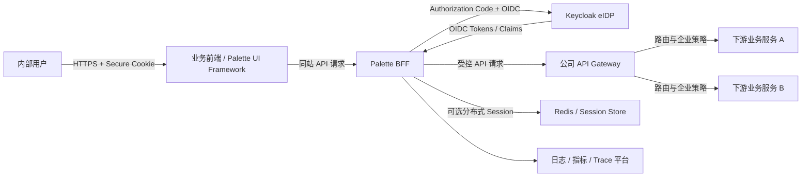
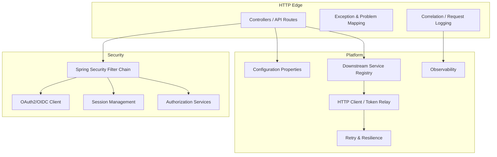
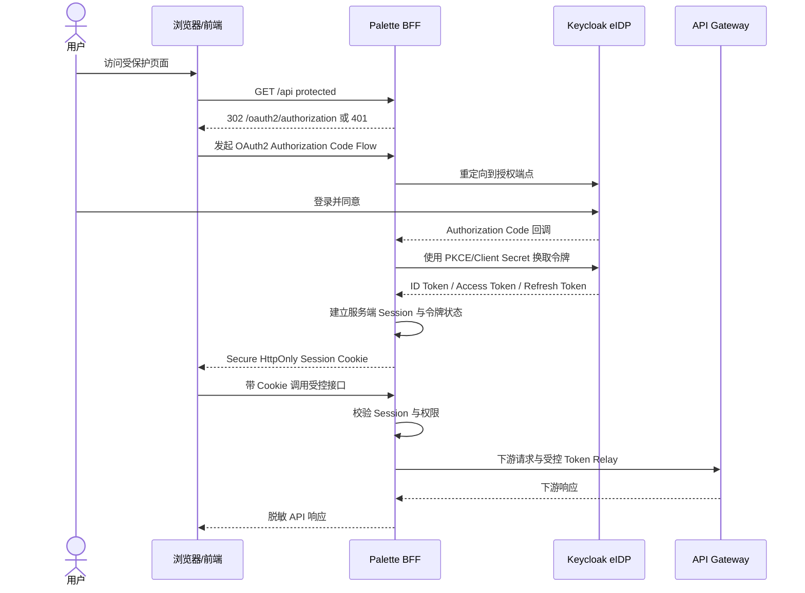

# Palette BFF 架构设计

## 1. 定位

Palette BFF 是面向内部浏览器应用的安全交互层，负责：

- OIDC 登录与企业身份集成。
- 浏览器安全 Session 与服务端令牌管理。
- 下游 API 的受控路由、认证中继和统一错误映射。
- 应用级认证、授权、会话生命周期和审计。
- 平台级请求关联、日志、指标和健康检查。

Palette BFF 不承载业务领域逻辑，也不替代公司级 API Gateway。

## 2. 系统上下文



系统边界内外：

- BFF 内部：认证流程、Session、令牌、受控代理、公共平台能力。
- 下游和 Gateway 外部：业务领域逻辑、网关限流、企业策略和数据所有权。
- 企业 IdP 外部：身份真实性、用户目录、账号和角色信息由 Keycloak 或企业目录提供。

## 3. 推荐逻辑架构



推荐的初始包结构：

```text
com.palette.bff
├── PaletteBffApplication.java
├── config
├── security
│   ├── oauth
│   ├── session
│   └── authorization
├── downstream
├── api
├── error
├── observability
└── common
```

初始阶段保持扁平模块，业务能力不能直接进入核心包。演进为多模块前需通过 ADR确认。

## 4. OIDC 登录交互时序



## 5. 部署模型

### 选项 A：单实例 BFF（MVP）

优点：部署简单、调试成本低、适合少量用户或验证阶段。

限制：水平扩展需要 Sticky Session 或集中式 Session Store；令牌刷新和故障恢复需要完整验证。

### 选项 B：无状态应用 + 分布式 Session

优点：支持水平扩展、滚动发布和实例故障恢复。

主要风险：Redis 依赖、可用性、密钥和会话数据治理。

### 选项 C：按业务域部署专用 BFF 实例

优点：隔离业务接入、版本、配额和故障。

限制：公共能力复用、重复部署与运维成本更高。

### 推荐方案

- MVP：单服务、可配置、允许本地和分布式 Session 扩展点。
- 生产：优先无状态应用 + 企业批准的集中式 Session，具体存储最终由企业基础设施确认。
- 默认同类业务应用共享公共 BFF，只有明确安全或扩展隔离需求时按业务域拆分。

## 6. 可复用模式

1. Shared Service：业务应用直接部署同一公共 BFF 实例。
2. Template：为业务应用提供标准配置和参考实现。
3. Starter/Library：仅封装真正稳定且通用的横切能力。
4. Independent Instance：针对强隔离和独立生命周期的业务域提供专用实例。

MVP 推荐 Shared Service + Template，不预先构建复杂共享库。

## 7. 核心质量属性

- 安全：安全 Cookie、CSRF、Session 固定保护、受控代理、令牌脱敏。
- 可用性：健康检查、超时、降级和会话故障策略。
- 可扩展性：配置驱动下游注册，无有状态单实例强依赖。
- 可观测性：关联 ID、结构化日志、指标、Trace 和审计。
- 可维护性：Spring 原生能力、单一职责、清晰模块边界。
- 向后兼容：稳定 API、配置兼容和渐进迁移。

## 8. MVP 验收边界

- 能编译、测试、打包并启动。
- Hello API 和 Actuator 可访问。
- 基础错误、关联 ID 和日志可验证。
- 本地 Mock IdP 可完成登录生命周期验证。
- 下游目标只能来自受控配置。
- 生产范围不暴露真实密钥或令牌。

## 9. 后续演进

Step 1 至 Step 15 按照单一职责增量实施。每个 Step 增加边界和测试，不在 Step 0 引入认证、代理、Session 或业务实现代码。
