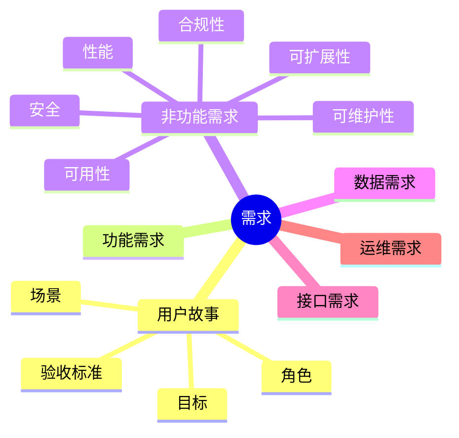
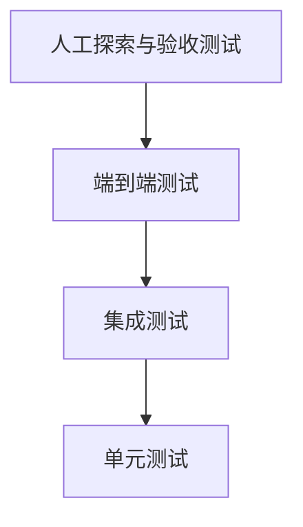
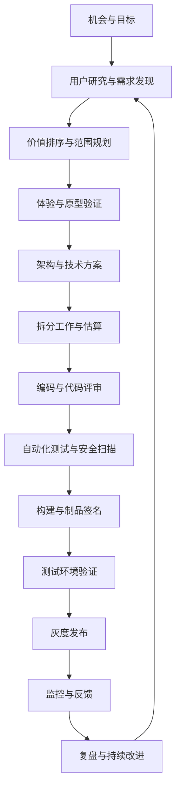
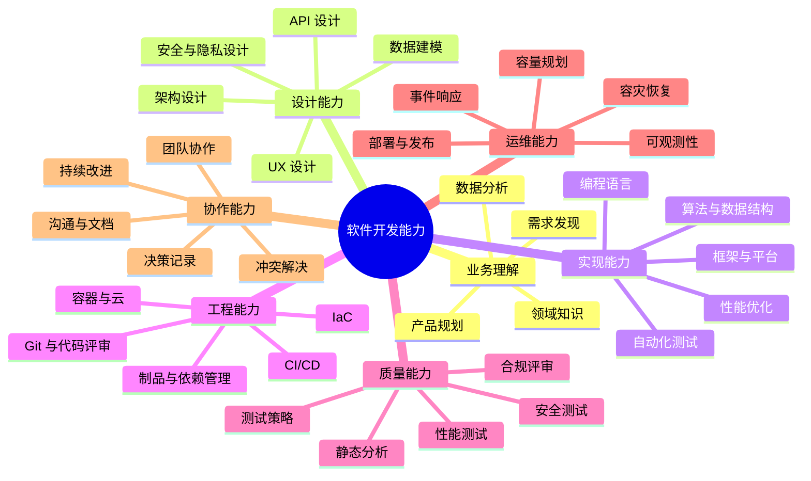

# 软件开发全景图

> 本文用于从宏观到微观梳理软件开发的完整生命周期、关键角色、主要流程、技术体系与工程实践。

## 一、软件开发全局视角

软件开发不仅是写代码，而是一套将业务需求、技术方案、组织协作、质量保障、交付运维和持续改进联系起来的系统工程。

核心目标包括：

1. **有效性**：交付真正解决用户问题和业务问题的产品。
2. **可靠性**：在正常和异常情况下稳定运行。
3. **可维护性**：代码、架构、文档和流程易于理解与演进。
4. **安全性**：保护数据、系统和用户免受威胁。
5. **可扩展性**：支持用户量、数据量和组织规模增长。
6. **经济性**：在成本、速度、质量和风险之间取得平衡。

---

## 二、软件生命周期

### 2.1 从想法到价值

| 阶段 | 核心问题 | 主要产物 |
|---|---|---|
| 战略与机会识别 | 为什么做？为谁做？创造什么价值？ | 产品愿景、市场分析、业务目标 |
| 需求发现 | 用户遇到什么问题？ | 用户画像、用户旅程、需求假设 |
| 规划 | 先做什么？以什么方式验证？ | Roadmap、里程碑、优先级 |
| 设计 | 如何满足需求并保证可用性？ | 原型、用户流程、架构、技术方案 |
| 开发 | 如何以可控方式实现？ | 源代码、自动化测试、文档 |
| 验证 | 是否正确、完整、可靠和安全？ | 测试报告、质量门禁、发布候选 |
| 发布 | 如何低风险地交付给用户？ | 制品、部署清单、灰度方案 |
| 运行 | 系统是否健康？是否产生预期价值？ | 日志、指标、告警、事件记录 |
| 反馈与演进 | 下一步应改进什么？ | 数据洞察、复盘、需求迭代 |

### 2.2 典型交付模型

- **瀑布模型**：阶段明确，适合需求相对固定、合规要求严格的场景。
- **迭代模型**：分批构建并逐步完善，适合需求持续演进的项目。
- **敏捷开发**：小批量、短周期、持续反馈，例如 Scrum、Kanban、XP。
- **精益开发**：以用户价值为中心，减少等待、返工和不必要工作。
- **DevOps / 平台工程**：打通开发、测试、发布、运维与度量。
- **持续交付**：始终保持软件处于可发布状态。

---

## 三、项目启动与治理

### 3.1 立项信息

项目启动前应至少明确：

- 项目背景与商业目标
- 目标用户与关键场景
- 范围与非目标
- 成功指标与验收标准
- 预算、期限与资源
- 法律、合规、隐私与安全约束
- 已知风险和依赖
- 决策机制与汇报机制

### 3.2 成功指标

- **业务指标**：收入、留存、转化、成本、满意度
- **用户指标**：活跃度、任务完成率、响应时间、投诉率
- **质量指标**：缺陷率、缺陷逃逸率、可用性、恢复时间
- **交付指标**：交付周期、部署频率、变更失败率、修复时间
- **工程指标**：构建成功率、测试覆盖率、技术债、代码评审速度

指标应形成因果链，例如：缩短交付周期 → 更快获得反馈 → 更快修正方向 → 提升留存和收入。

### 3.3 风险管理

常见风险包括：需求不确定、技术不可行、外部依赖延迟、资源不足、数据质量差、安全合规问题、性能瓶颈、供应商锁定、团队协作与知识断层。

风险处理方式：规避、降低、转移、接受，并持续跟踪风险概率、影响、负责人和应对时间。

---

## 四、产品与需求工程

### 4.1 需求来源

- 用户访谈和可用性测试
- 客户反馈与工单
- 产品数据与行为分析
- 市场和竞品研究
- 管理和合规要求
- 系统演进和技术债治理

### 4.2 需求分解

优先级可结合：

- 用户价值
- 业务价值
- 成本与复杂度
- 风险与不确定性
- 时间敏感性
- 合规要求
- 对战略目标的贡献

常用方法包括 MoSCoW、RICE、Kano 和四象限排序。

### 4.3 验收标准

好的需求应尽量满足：

- 可理解
- 可验证
- 可追踪
- 无明显歧义
- 包含异常与边界场景
- 明确不做的内容
- 明确数据、权限和兼容性要求

---

## 五、用户体验与产品设计

### 5.1 设计流程

1. 用户研究
2. 用户画像与场景建模
3. 用户旅程地图
4. 信息架构
5. 任务流程
6. 低保真原型
7. 可用性验证
8. 高保真界面
9. 设计规范与组件库
10. 上线后体验度量

### 5.2 设计关注点

- 一致性和可预测性
- 可发现性和可操作性
- 响应反馈与状态提示
- 错误预防与恢复
- 无障碍访问
- 多终端和国际化适配
- 加载、空态、异常态和离线态
- 隐私与知情同意

---

## 六、软件架构与技术设计

### 6.1 架构核心问题

架构定义了系统的组成、职责、边界、数据流、通信方式和演进约束。

需要回答：

- 业务能力如何拆分？
- 模块与服务如何通信？
- 数据由谁拥有和管理？
- 状态放在哪里？
- 失败如何隔离？
- 依赖如何控制？
- 如何演进和扩容？
- 如何观测、部署和恢复？

### 6.2 常见架构风格

| 架构风格 | 适用场景 | 主要关注点 |
|---|---|---|
| 单体架构 | 小团队、初创产品、领域尚不稳定 | 简单部署、强一致性、快速迭代 |
| 分层架构 | 典型企业应用 | 职责分离、依赖方向清晰 |
| 模块化单体 | 中型系统且希望保持部署简单 | 模块边界、共享核心能力 |
| 微服务 | 组织规模大、独立演进需求强 | 服务边界、分布式复杂度、运维成本 |
| 事件驱动 | 异步解耦、流处理、实时场景 | 最终一致性、消息可靠性、可追踪性 |
| 六边形/端口适配器 | 领域逻辑复杂、需要替换外部能力 | 依赖倒置、可测试性 |
| 无服务器 | 短生命周期任务、突发流量、轻运维 | 冷启动、成本、供应商依赖 |

不存在“天然最先进”的架构，应该根据团队能力、业务复杂度、规模、合规和演进速度选择。

### 6.3 架构图类型

- 上下文图：系统与外部角色、系统的关系
- 容器图：应用、服务、数据库、消息系统等运行单元
- 组件图：内部模块和依赖关系
- 部署图：进程、机器、容器、网络和区域
- 数据流图：数据来源、传输、处理和存储
- 时序图：关键交互与消息顺序
- 状态图：状态及状态迁移

### 6.4 技术方案评审

方案至少包括：

- 背景与约束
- 目标与非目标
- 候选方案
- 技术取舍
- 数据与接口设计
- 容量与性能估算
- 安全与合规
- 可用性与灾备
- 可观测性
- 发布与回滚
- 测试策略
- 迁移与兼容性
- 运维和成本
- 风险与验证计划

重要决策应形成 ADR（Architecture Decision Record），记录决策、背景、备选方案和后果。

---

## 七、技术栈全貌

### 7.1 客户端与前端

- Web：HTML、CSS、JavaScript、TypeScript
- 框架：React、Vue、Angular、Svelte 等
- 移动端：原生 iOS/Android、跨平台框架
- 桌面端：Electron、Tauri、原生桌面技术
- 状态管理、路由、表单、权限、组件库、国际化
- 渲染与性能：CSR、SSR、SSG、流式渲染、缓存、懒加载
- 前端质量：单元测试、组件测试、端到端测试、性能预算

### 7.2 服务端与后端

- 语言：Java、Go、Python、JavaScript/TypeScript、C#、PHP、Ruby、Rust、C/C++ 等
- 框架：Spring、.NET、Django、FastAPI、Gin、Express、Nest 等
- API：REST、GraphQL、RPC、gRPC、WebSocket、事件消息
- 任务：同步请求、异步任务、定时任务、流处理、批处理
- 横切能力：认证、鉴权、日志、限流、重试、幂等、事务、配置

### 7.3 数据技术

- 关系型数据库：MySQL、PostgreSQL、SQL Server、Oracle
- 文档数据库：MongoDB、Elasticsearch 等
- 键值与缓存：Redis、Memcached
- 消息队列：Kafka、RabbitMQ、Pulsar、RocketMQ
- 搜索引擎：Elasticsearch、OpenSearch
- 数据仓库与湖仓：Snowflake、BigQuery、Databricks、Lakehouse
- 数据处理：批处理、流处理、ETL/ELT
- 数据治理：模型、血缘、质量、元数据、权限、生命周期

### 7.4 基础设施与云

- 操作系统与网络
- DNS、负载均衡、CDN、API 网关
- 虚拟机、容器、Kubernetes
- 云服务：计算、存储、数据库、网络、身份、密钥、AI
- IaC：Terraform、Pulumi、CloudFormation
- 配置管理：Ansible、Chef、Puppet
- 私有云与混合云

### 7.5 通用工程工具

- 代码托管：Git 平台
- IDE 与编辑器
- 依赖与制品管理
- 静态分析与格式化
- 构建和打包工具
- 自动化测试平台
- 发布和部署工具
- 文档与知识管理
- 项目与协作平台
- 通信与会议工具

---

## 八、软件工程方法

### 8.1 编程与代码质量

- 单一职责和清晰抽象
- 有意义的命名
- 小函数、低认知复杂度
- 避免过度设计
- 尽量减少全局状态与隐藏副作用
- 明确错误处理和边界条件
- 使用类型系统表达约束
- DRY、KISS、YAGNI 应以具体场景权衡
- 代码评审关注正确性、可读性、性能、安全和维护成本

### 8.2 测试金字塔与测试策略

通常越低层的测试越快、越便宜、越稳定；越高层的测试越接近真实用户和系统，但运行更慢且维护成本更高。

测试类型：

- 单元测试
- 集成测试
- API 测试
- 合约测试
- 端到端测试
- 性能测试
- 负载和压力测试
- 混沌与容错测试
- 安全测试
- 无障碍测试
- 兼容性测试
- 可用性测试
- 回归测试

### 8.3 软件质量属性

- 功能正确性
- 性能与容量
- 可用性与容错性
- 可扩展性
- 可维护性与可演进性
- 可观测性
- 安全与隐私
- 部署与恢复能力
- 可移植性与兼容性
- 用户体验和可访问性

质量不能只靠最终测试，应从需求、设计、编码、评审、构建、部署和运行全链路控制。

---

## 九、API 与集成设计

### 9.1 接口设计原则

- 明确资源或能力边界
- 使用稳定且一致的命名
- 校验输入和限制大小
- 返回结构化错误
- 保持向后兼容
- 使用幂等键处理重复请求
- 明确超时、重试、限流和降级
- 对敏感操作进行授权与审计
- 为接口提供文档、示例和版本策略

### 9.2 分布式系统难点

- 网络不可靠
- 服务可能部分失败
- 时钟和顺序不一致
- 数据状态最终一致
- 重试可能重复执行
- 请求可能超时且结果未知
- 跨服务事务难以保证
- 依赖雪崩和级联故障
- 调试和链路追踪复杂

常用模式包括：超时、重试、退避、断路器、舱壁、限流、幂等、消息去重、事务补偿、Saga、事件溯源、CQRS。

---

## 十、数据库与数据管理

### 10.1 数据建模

- 明确实体、关系、生命周期和所有权
- 区分源数据、派生数据和缓存数据
- 数据一致性与事务边界
- 合理使用索引和避免不必要索引
- 考虑历史、归档、删除和审计
- 数据迁移和向后兼容
- 隐私脱敏和访问控制

### 10.2 分布式数据问题

需要权衡：一致性、可用性、分区容忍、延迟、数据冗余、复制、分片、跨区域部署、备份恢复。

可靠的数据系统应有：

- 数据校验
- 备份与恢复演练
- 主键和约束
- 演进式数据库迁移
- 可观测性
- 审计与回滚能力
- 容量规划

---

## 十一、DevOps 与持续交付

### 11.1 持续集成

持续集成通常包括：

1. 提交代码
2. 自动构建
3. 静态检查
4. 运行自动化测试
5. 执行安全扫描
6. 打包不可变制品
7. 发布到测试环境
8. 验证部署健康

核心目标是尽早发现错误，并确保每次提交都能产出可信制品。

### 11.2 部署与发布策略

- Rolling Update：逐步替换实例
- 蓝绿部署：在新旧环境间切换
- 金丝雀发布：先对少量流量或用户开放
- 功能开关：运行时启停功能
- 影子流量：仅将流量副本送入新版本
- 不可变基础设施：每次部署替换而不是原地修改

发布前应准备：

- 健康检查
- 回滚方案
- 数据兼容方案
- 配置与密钥管理
- 发布检查清单
- 监控和告警验证

### 11.3 CICD 与部署流水线

流水线应快速反馈、可重复、可审计、可追踪，并尽量减少手工步骤。

---

## 十二、基础设施即代码与平台工程

### 12.1 Infrastructure as Code

基础设施以可版本化、可审查、可重复的代码管理，包括：

- 网络和安全组
- 计算资源
- 数据库和存储
- 权限和身份
- DNS 和负载均衡
- Kubernetes 配置
- 密钥和证书
- 日志与监控资源

### 12.2 平台工程

平台团队为业务团队提供内部开发平台和自助能力，例如：

- 标准项目模板
- 构建与部署流水线
- 开发环境与测试环境
- 权限和配额管理
- 可观测性组件
- 服务目录
- 成本和资源管理
- 安全合规默认配置

目标不是限制团队，而是减少认知负担并缩短交付周期。

---

## 十三、可观测性与运维

### 13.1 可观测性三支柱

- **日志**：离散事件和上下文
- **指标**：随时间变化的数值
- **链路**：一次请求在各组件中的完整过程

现代实践还包括事件、剖析、用户体验监测和审计日志。

### 13.2 核心指标

- 可用性与成功率
- 延迟分位数，如 P50、P95、P99
- 吞吐量
- 错误率
- 饱和度与容量
- 队列长度
- 数据消费滞后
- 部署失败与回滚次数
- 资源成本

使用服务级指标可帮助判断：

- 用户是否能完成关键任务？
- 服务是否快速且稳定？
- 是否存在容量或依赖风险？
- 哪次变更导致异常？

### 13.3 告警与事件响应

告警应可操作、可量化且避免告警疲劳。告警中应包含：

- 受影响的服务和用户
- 服务级目标
- 当前影响
- 仪表盘和日志入口
- 已知运行手册
- 负责人和升级路径

事件处理包括：发现、分诊、止损、恢复、沟通、根因分析、改进跟踪和复盘。

---

## 十四、安全与合规

### 14.1 安全左移与纵深防御

安全应贯穿整个生命周期：

- 威胁建模
- 安全需求与权限设计
- 安全编码规范
- 依赖漏洞扫描
- 秘密检测
- 静态与动态安全测试
- 制品签名与供应链验证
- 部署策略与最小权限
- 日志审计与入侵检测
- 漏洞响应和修复

### 14.2 常见风险

- 注入攻击
- 身份和会话缺陷
- 越权访问
- 敏感数据泄露
- 不安全的依赖
- 日志或错误信息泄密
- 不安全的配置
- 供应链攻击
- 业务逻辑漏洞
- 权限过度和密钥泄露

### 14.3 合规与治理

根据业务和地区要求可能涉及：

- 数据保护与隐私
- 行业监管
- 数据本地化
- 留存与删除
- 审计和追溯
- 访问审批
- 第三方风险管理
- 记录和证据管理

安全与合规不是只在上线前补救，而是需要自动化、可审计和可持续执行。

---

## 十五、团队协作与组织结构

### 15.1 常见角色

| 角色 | 核心职责 |
|---|---|
| 产品负责人 | 产品方向、需求优先级、价值目标 |
| 产品经理 | 用户研究、需求定义、验证与规划 |
| 项目/交付经理 | 计划、风险、依赖、协调与状态透明 |
| 业务分析师 | 业务规则、流程、需求和验收标准 |
| UX/UI 设计师 | 研究、流程、原型、界面和体验规范 |
| 软件架构师 | 技术方向、架构决策、复杂度治理 |
| 前端工程师 | 浏览器、移动或桌面用户界面 |
| 后端工程师 | 业务逻辑、数据、API 和集成 |
| 测试工程师 | 测试策略、质量保障、缺陷与风险管理 |
| DevOps/SRE 工程师 | 平台、交付、可靠性和事件恢复 |
| 数据工程师 | 数据管道、平台、质量和治理 |
| 安全工程师 | 威胁建模、安全控制、审计和响应 |
| 技术负责人 | 技术决策、团队能力、交付质量 |

角色可以重叠，关键是职责清晰、决策透明、沟通顺畅。

### 15.2 团队拓扑

常见团队关系包括：

- Stream-aligned Team：围绕用户或业务价值流组织
- Enabling Team：帮助其他团队建立能力
- Platform Team：提供基础能力和自助平台
- Complicated-subsystem Team：负责高度专业化子系统

好的组织结构应减少跨团队等待和手工移交，使团队有端到端交付能力。

---

## 十六、敏捷与项目执行

### 16.1 Scrum 核心环节

- Product Backlog：需求池
- Sprint Planning：确定本周期目标
- Daily Scrum：协调进展和障碍
- Development：增量实现和验证
- Sprint Review：展示并收集反馈
- Retrospective：改进协作方式

Scrum 不等于只开会，其价值是建立短反馈循环和持续改进机制。

### 16.2 Kanban

Kanban 关注：

- 可视化工作流
- 限制在制品
- 管理流动
- 明确策略与规则
- 建立反馈和持续改进

适合工作类型多变、需要持续流式交付的团队。

### 16.3 研发实践

- 小批量提交
- 分支策略：短分支、主干开发或受控发布分支
- 代码评审
- 配对编程或结对评审
- 自动化检查
- 定义完成（DoD）
- 技术债透明化
- 可复现构建
- 发布与回滚演练

---

## 十七、软件交付制品与文档

### 17.1 主要制品

- 源代码和版本记录
- 构建脚本和配置
- 软件包、容器镜像或可部署包
- 数据库迁移脚本
- API 文档和 SDK
- 测试报告与覆盖率报告
- 安全扫描和合规报告
- 部署清单和变更记录
- 日志、指标、告警和链路配置
- 运维手册与故障预案

制品应具有来源、版本、校验、依赖和可追溯信息。

### 17.2 文档体系

推荐将文档分为：

- 面向客户的使用文档
- 面向开发者的架构和接口文档
- 面向运维的部署和恢复文档
- 面向管理者的目标、进度和决策文档
- 面向团队的开发规范和流程文档
- ADR 和技术决策记录

文档应尽量贴近代码和流水线，避免长期脱节。

---

## 十八、度量与持续改进

### 18.1 四大交付指标

- 部署频率
- 交付周期
- 变更失败率
- 修复或恢复时间

结合软件质量和用户价值指标，可以形成更完整的系统性评价。

### 18.2 避免错误度量

- 单纯追求代码行数
- 只看覆盖率而不看有效性
- 只看功能交付数量而忽略价值
- 使用个人指标制造竞争压力
- 将活动量等同于成果
- 在缺乏目标和上下文时比较团队

度量应用于发现问题、改进系统，而不是仅用于考核个人。

### 18.3 复盘机制

复盘聚焦四个问题：

1. 原来预期是什么？
2. 实际发生了什么？
3. 差异原因是什么？
4. 接下来做出哪些可验证的改进？

失败复盘应强调系统性原因和心理安全，而不是找替罪羊。

---

## 十九、软件演进与技术债

### 19.1 技术债来源

- 期限压力导致的临时方案
- 缺失或过时的测试
- 不清晰的模块边界
- 老旧依赖
- 配置和部署不一致
- 单点和重复逻辑
- 缺失文档
- 团队知识断层
- 架构与业务演进脱节

### 19.2 治理策略

- 技术债可见化并登记
- 按风险和价值排序
- 与功能需求一起规划
- 增量重构
- 建立质量门禁
- 执行依赖升级
- 优化可观测性和自动化
- 避免一次性大爆炸改造

重构目标是改善内部结构且不改变外部行为；架构演进应以可验证的业务和技术收益为依据。

---

## 二十、软件开发全景流程模板

下面是一套适合多数中大型软件项目的参考流程：

### 推荐的质量门禁

- 需求和验收标准明确
- 架构和安全风险已评估
- 单元、集成与关键场景测试通过
- 静态检查和依赖扫描无高危问题
- 制品可追溯且可重复构建
- 回滚方案已准备
- 可观测性覆盖关键链路
- 发布检查和告警验证完成
- 数据迁移可回退或前向兼容
- 上线影响和沟通计划已明确

---

## 二十一、现代软件开发能力地图

---

## 二十二、可用于项目落地的检查清单

### 产品与需求

- [ ] 问题、用户、价值和目标明确
- [ ] 成功指标和验收标准明确
- [ ] 范围与非目标明确
- [ ] 风险、依赖和约束已识别
- [ ] 已验证关键假设

### 体验与设计

- [ ] 用户旅程完整
- [ ] 主流程和异常流程明确
- [ ] 原型经过用户或业务验证
- [ ] 无障碍和国际化已考虑
- [ ] 空态、加载态、错误态已设计

### 架构与实现

- [ ] 业务边界和模块职责清晰
- [ ] 数据所有权明确
- [ ] API 和数据库兼容策略明确
- [ ] 核心失败场景有降级方案
- [ ] 安全和隐私按最小权限设计
- [ ] 日志、指标和链路覆盖关键流程
- [ ] 技术方案和决策已有记录

### 质量与交付

- [ ] 测试策略覆盖高价值风险
- [ ] 流水线可快速失败并清晰反馈
- [ ] 制品不可变且可追踪
- [ ] 部署、回滚和数据迁移可验证
- [ ] 发布时有监控和告警检查
- [ ] 回归和验收流程明确

### 运维与治理

- [ ] 可用性目标和告警阈值明确
- [ ] 备份恢复已演练
- [ ] 容量和成本已评估
- [ ] 关键应急手册可执行
- [ ] 演练、复盘和改进闭环存在
- [ ] 文档和知识可持续维护

---

## 二十三、总结

软件开发的完整图景可以概括为：

> **以用户价值为起点，以架构和工程为手段，以质量、安全和可靠性为约束，以数据反馈为依据，以持续交付和演进为目标。**

优秀的软件组织不是追求某一种流程或技术，而是在需求不确定性、技术复杂性、交付风险、组织协作和成本之间建立可持续的平衡机制，并通过短反馈、自动化、可观测性和持续改进不断提高交付能力。
