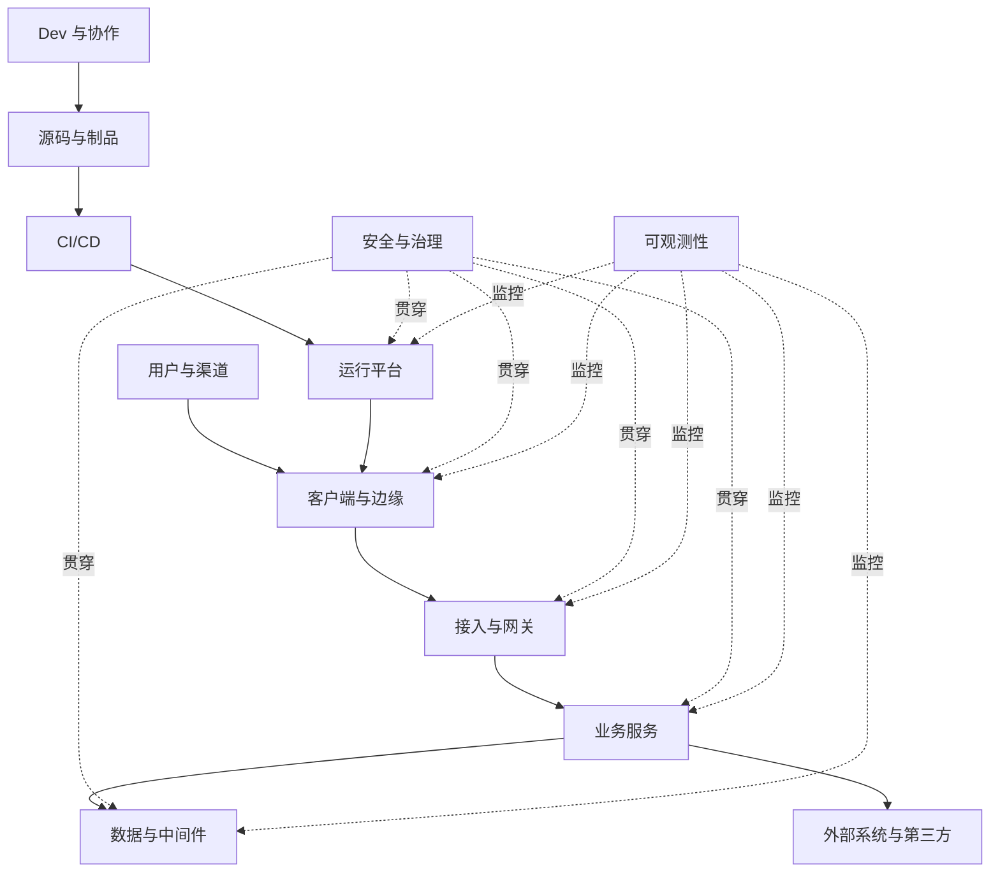
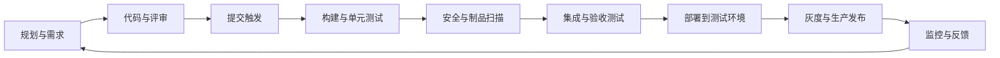

# 软件开发技术栈全貌

> 本文梳理现代软件开发涉及的主流技术、工具、平台与能力边界，供架构选型、团队技术规划和学习路线使用。

## 一、技术栈总览

一套完整技术栈通常包括：

- 前端与移动端技术
- 服务端与业务框架
- 数据存储与数据处理
- 中间件与集成技术
- 云计算与基础设施
- 容器与编排
- CI/CD 与交付平台
- 安全与合规
- 可观测性与运维
- AI 与数据智能
- 开发者工具和协作平台

---

## 二、编程语言地图

| 语言 | 典型用途 | 优势 | 主要考虑 |
|---|---|---|---|
| JavaScript / TypeScript | Web 前端、Node.js、全栈、工具 |生态丰富、前后端同语言、类型可增强 |运行时差异、依赖与性能治理 |
| Java | 企业应用、互联网后端、Android 生态 |成熟框架、稳定性、人才多、生态完整 |启动成本、内存与容器资源占用 |
| Kotlin | Android、服务端、跨平台 |现代语法、与 Java 互操作、空安全 |生态学习成本、团队规范 |
| C# / .NET | 企业后端、桌面、游戏、云服务 |类型安全、跨平台、工具成熟 |平台生态与 Windows 历史依赖 |
| Python | AI、数据、脚本、Web 后端、自动化 |生产力高、AI 与数据生态领先 |并发、类型和运行性能 |
| Go | 云原生、微服务、基础设施、并发系统 |编译快、部署简单、并发模型清晰 |泛型表达力与生态相对精简 |
| Rust | 系统软件、基础设施、性能敏感模块 |内存安全、高性能、并发可靠 |学习曲线陡、开发成本较高 |
| C / C++ | 操作系统、嵌入式、游戏引擎、高性能计算 |性能接近硬件、生态成熟 |内存安全和开发复杂度 |
| PHP | Web 后端、内容平台、业务系统 |部署成熟、生态和人才丰富 |需要规范以控制项目复杂度 |
| Ruby | Web 后端、脚本、自动化 |开发效率高、表达力强 |并发和运行性能需要关注 |
| Swift | iOS、macOS、跨平台原生应用 |安全、现代、苹果生态集成好 |主要面向 Apple 平台 |
| Dart | Flutter 跨平台应用 |一套代码覆盖多端、热重载 |生态和运行时边界需评估 |

### 语言选择原则

- 优先考虑团队现有能力和生态成熟度。
- 明确性能、并发、启动时间、内存和部署约束。
- 区分一次性脚本与长期演进的核心系统。
- 评估人才获取、招聘成本和供应链风险。
- 不应仅因语言流行度选择技术。

---

## 三、客户端技术栈

### 3.1 Web 前端

**基础技术：**

- HTML
- CSS
- JavaScript
- TypeScript
- Web Components
- WebAssembly

**主流框架：**

- React / Next.js
- Vue / Nuxt
- Angular
- Svelte / SvelteKit
- Solid.js
- Astro
- Lit

**常用能力：**

- 路由与导航
- 状态管理
- 表单与校验
- 国际化与本地化
- 权限与身份集成
- 组件库与设计系统
- 请求缓存与离线能力
- 微前端
- 服务端渲染和静态生成

**构建与工具：**

- npm / pnpm / Yarn
- Vite
- Turbopack
- Webpack
- esbuild / SWC
- ESLint
- Prettier
- Biome
- Storybook
- Vitest / Jest
- Playwright / Cypress
- Lighthouse / WebPageTest

### 3.2 移动端

**原生：**

- iOS：Swift、SwiftUI、UIKit
- Android：Kotlin、Java、Jetpack Compose

**跨平台：**

- Flutter / Dart
- React Native
- Kotlin Multiplatform
- MAUI
- Ionic
- Expo

**移动端关注点：**

- 离线与弱网
- 生命周期和后台任务
- 推送通知
- 安装包与热更新策略
- 权限和隐私
- 包体积与启动速度
- 崩溃分析
- 真机兼容性
- 深链接和端到端流量追踪

### 3.3 桌面与嵌入式

- Electron
- Tauri
- Qt
- MAUI
- 原生 macOS/Windows/Linux 技术
- Linux 和 RTOS
- 鸿蒙、车载系统和物联网设备

桌面或嵌入式应用需要重点关注本地资源、自动更新、离线、系统权限、兼容性和发布签名。

---

## 四、后端与服务端技术栈

### 4.1 Java

- Spring Boot / Spring Framework
- Spring Cloud
- Jakarta EE / Quarkus / Micronaut
- Maven / Gradle
- JUnit、Mockito、Testcontainers
- JVM 性能分析和垃圾回收调优

适合大型企业系统、复杂领域和高成熟度运维场景。

### 4.2 Go

- Gin / Echo / Fiber
- gRPC / Connect
- Go Modules
- Kubernetes 和云原生生态
- 原生并发和标准库

适合 API、网关、控制面、基础设施、并发和高吞吐服务。

### 4.3 Python

- FastAPI
- Django
- Flask
- Celery
- SQLAlchemy
- pytest
- Pyright / mypy
- Ruff

适合 AI、数据平台、快速原型、脚本、接口和业务后台。

### 4.4 .NET

- ASP.NET Core
- Entity Framework
- Dapper
- xUnit / NUnit / MSTest
- Blazor
- gRPC

适合企业应用、云原生服务、桌面应用和 Microsoft 技术体系。

### 4.5 Node.js

- Express
- NestJS
- Fastify
- Hono
- Prisma / Drizzle
- Socket.IO
- Bun / Deno

适合全栈应用、API、实时通信和快速交付。

### 4.6 其他方向

- Ruby on Rails
- Laravel / Symfony
- Rust：Axum、Actix、Tokio
- C/C++：高性能网络、系统和游戏引擎
- PHP：WordPress、Laravel 和大型 Web 平台

---

## 五、API 与通信协议

### 5.1 REST

适合资源型、公开型和通用型接口。

重点：

- HTTP 方法语义
- 状态码
- 分页、过滤和排序
- 幂等性
- 缓存
- 错误响应模型
- OpenAPI
- 版本兼容策略

### 5.2 GraphQL

适合聚合多源数据或支持变化较大的客户端。

重点：

- Schema 和类型设计
- Resolver 性能
- N+1 查询
- 查询复杂度和深度限制
- 缓存
- 权限粒度

### 5.3 RPC 与 gRPC

适合内部高性能服务通信。

重点：

- Protocol Buffers
- 兼容的二进制协议
- 流式调用
- 超时和重试
- 服务发现
- 负载均衡
- 可观测性

### 5.4 实时通信

- WebSocket
- Server-Sent Events
- WebTransport
- MQTT
- STOMP
- Socket.IO

适合聊天、协作、推送、实时控制和事件订阅。

### 5.5 异步消息

- Kafka
- RabbitMQ
- Pulsar
- RocketMQ
- Azure Service Bus
- AWS SNS/SQS
- Google Pub/Sub
- Redis Streams
- NATS

核心问题包括：消息顺序、重复消费、幂等、死信、重试、积压、吞吐和最终一致性。

---

## 六、数据库技术栈

### 6.1 关系型数据库

- PostgreSQL
- MySQL
- MariaDB
- SQL Server
- Oracle
- SQLite
- CockroachDB
- YugabyteDB
- TiDB

适合结构化数据、事务、复杂查询和一致性要求较强的场景。

### 6.2 文档与键值数据库

- MongoDB
- Couchbase
- DynamoDB
- Redis
- Memcached
- RocksDB
- Amazon DocumentDB

适合灵活数据结构、缓存、会话、对象存储索引或分布式键值场景。

### 6.3 搜索与向量数据库

- Elasticsearch
- OpenSearch
- Solr
- Meilisearch
- Typesense
- Pinecone
- Milvus
- Weaviate
- pgvector
- FAISS

适合全文检索、日志检索、相似度检索、RAG 和语义搜索。

### 6.4 时序与图数据库

- 时序：InfluxDB、TimescaleDB、VictoriaMetrics、Prometheus
- 图：Neo4j、JanusGraph、Amazon Neptune

适合监控指标、传感器、日志、关系网络和知识图谱。

### 6.5 数据仓库与湖仓

- Snowflake
- Google BigQuery
- Databricks
- Amazon Redshift
- ClickHouse
- Apache Doris
- Apache Doris 及 OLAP 生态
- Apache Iceberg
- Delta Lake
- Apache Hudi

适合分析、数据湖、批处理、流处理和大规模历史数据。

### 6.6 数据库周边

- ORM：Hibernate、Entity Framework、SQLAlchemy、Prisma、Drizzle
- 迁移：Flyway、Liquibase、Alembic、Prisma Migrate
- 连接池：HikariCP、PgBouncer
- 多租户、分库分表和读写分离
- 备份恢复、复制、审计和脱敏

---

## 七、缓存与高并发技术

常用组件：

- Redis / Valkey
- Memcached
- CDN
- 本地缓存
- 对象存储
- 消息队列
- 限流系统
- 负载均衡器
- 连接池

缓存模式：

- Cache-aside
- Read-through
- Write-through
- Write-behind
- Multi-level cache
- CDN 缓存

关键风险：

- 缓存穿透、击穿、雪崩
- 数据陈旧和一致性
- 热键和大 Key
- 限流不准确
- 重试放大流量
- 分布式锁滥用

---

## 八、云计算与基础设施

### 8.1 公有云

- AWS
- Microsoft Azure
- Google Cloud
- 阿里云
- 腾讯云
- 华为云

常见云能力：

- 计算：虚拟机、容器、函数、托管应用
- 存储：对象存储、块存储、文件存储
- 数据库：关系型、NoSQL、搜索、流处理
- 网络：VPC、负载均衡、DNS、专线、CDN
- 安全：IAM、KMS、WAF、Secret Manager
- 可观测性：日志、指标、追踪、告警
- AI：模型托管、向量、GPU、模型网关

### 8.2 容器与编排

- Docker / containerd
- Podman
- Kubernetes
- OpenShift
- Rancher
- Helm
- Kustomize
- Karpenter
- Istio / Linkerd
- Envoy

容器应交付包含：

- 不可变镜像
- 最小基础镜像
- 非 root 用户
- 镜像签名与扫描
- 固定版本和校验
- 健康检查
- 资源限制
- 安全上下文

### 8.3 Infrastructure as Code

- Terraform
- OpenTofu
- Pulumi
- AWS CloudFormation
- Azure Bicep
- Ansible
- Packer
- Crossplane

基础设施代码应具备：

- 模块化
- 环境隔离
- 状态安全
- 审查与计划
- 策略检查
- Drift 检测
- 最小权限
- 可销毁性

### 8.4 私有云与边缘

- VMware
- OpenStack
- Harvester
- K3s
- KubeEdge
- 边缘网关
- IoT 平台

适合离线、数据主权、低延迟、监管和地域隔离场景。

---

## 九、DevOps 与交付工具链

### 9.1 源码与协作

- Git
- GitHub / GitLab / Gitee / Azure DevOps
- 分支策略和代码评审
- Pull Request / Merge Request
- Issue 与项目管理
- ADR 与文档体系

### 9.2 构建与制品

- Maven / Gradle / Ant
- npm / pnpm / Yarn
- Go Modules
- Cargo
- pip / uv / Poetry
- NuGet
- Docker Registry
- Maven/NPM/PyPI/NuGet 仓库
- Artifactory / Nexus
- SLSA / Sigstore / Cosign

制品应支持不可变、可追溯、可签名和可回滚。

### 9.3 CI/CD 平台

- GitHub Actions
- GitLab CI
- Azure Pipelines
- Jenkins
- Argo CD
- Tekton
- Flux
- CircleCI
- Buildkite
- Harness
- Spinnaker

流水线能力应包括：

- 增量构建
- 并行测试
- 缓存
- 环境隔离
- 部署审批
- 自动回滚
- 供应链安全
- 审计日志

### 9.4 部署策略

- 滚动更新
- 蓝绿部署
- 金丝雀发布
- 分批发布
- 功能开关
- A/B 测试
- 影子流量
- 不可变基础设施

---

## 十、可观测性与运维

### 10.1 日志

常见平台：

- ELK / OpenSearch
- Loki
- Fluentd / Fluent Bit
- Vector
- Splunk
- 云日志服务

应包含：关联 ID、服务名、环境、版本、用户或租户脱敏标识、异常堆栈和结构化字段。

### 10.2 指标

- Prometheus
- Grafana
- VictoriaMetrics
- Datadog
- New Relic
- Dynatrace
- 云监控平台

重点指标：

- RED：Rate、Errors、Duration
- USE：Utilization、Saturation、Errors
- 黄金指标：延迟、流量、错误、饱和度
- SLA/SLO/SLI

### 10.3 分布式链路

- OpenTelemetry
- Jaeger
- Zipkin
- Tempo
- X-Ray
- SkyWalking

链路追踪用于定位跨服务、跨实例和跨依赖的延迟与失败。

### 10.4 性能与稳定性

- JMeter
- k6
- Gatling
- Locust
- wrk
- Artillery
- Chaos Mesh
- Litmus

还应包括容量测试、压力测试、长稳测试、故障注入和恢复演练。

---

## 十一、安全与隐私技术栈

### 11.1 身份与访问

- OAuth 2.0
- OpenID Connect
- SAML
- LDAP / Active Directory
- MFA
- Passkeys
- RBAC
- ABAC
- PBAC
- 零信任

主流产品：Keycloak、Auth0、Okta、Azure AD、AWS IAM、Zitadel。

### 11.2 应用与网络安全

- WAF
- API Gateway
- TLS/mTLS
- Secrets Manager
- KMS/HSM
- VPN / Zero Trust
- 防火墙与安全组
- DDoS 防护
- RASP

### 11.3 安全测试与治理

- SAST：静态代码分析
- DAST：动态应用安全测试
- IAST：交互式分析
- SCA：依赖和软件物料清单
- 容器镜像扫描
- 秘密扫描
- 威胁建模
- 漏洞管理
- SBOM
- 制品签名

常用工具包括：SonarQube、Semgrep、CodeQL、Trivy、Grype、Snyk、Dependabot、OWASP ZAP、Burp Suite。

### 11.4 数据安全与合规

- 最小权限
- 数据分类和标签
- 脱敏和匿名化
- 加密存储和传输
- 审计日志
- 密钥轮换
- 数据留存与删除
- 数据本地化
- 跨境数据控制

---

## 十二、测试与质量工具链

### 12.1 测试层次

- 单元测试
- 集成测试
- API/合约测试
- UI 组件测试
- 浏览器端到端测试
- 性能和负载测试
- 安全测试
- 无障碍测试
-兼容性测试
- 混沌和容错测试

### 12.2 常见工具

- Java：JUnit、Mockito、Testcontainers
- JavaScript：Vitest、Jest、Mocha、Cypress、Playwright
- Python：pytest、Hypothesis、Locust
- .NET：xUnit、NUnit、MSTest
- Go：testing、Testify、Gomega
- API：Postman、REST Assured、Karate、Pact
- 性能：JMeter、k6、Gatling、Locust
- 质量：SonarQube、Codecov、Coveralls

测试金字塔不是固定比例，而应按风险、成本和反馈速度动态调整。

---

## 十三、数据工程与数据平台

### 13.1 数据集成

- ETL/ELT
- CDC
- API 同步
- 文件与对象存储
- 数据交换格式：JSON、Avro、Parquet、Protobuf、CSV

工具包括：

- Apache Kafka
- Apache Flink
- Apache Spark
- Apache Beam
- Debezium
- Airbyte
- dbt
- Apache Airflow
- Dagster
- NiFi
- Microsoft Fabric

### 13.2 数据治理

- 元数据管理
- 数据目录
- 数据血缘
- 数据质量规则
- 数据所有权
- 数据契约
- 生命周期管理
- 访问审批与审计

### 13.3 常见数据架构

- 数据湖
- 数据仓库
- 湖仓一体
- 数据网格
- Lambda 架构
- Kappa 架构
- 流批一体
- Data Product

数据架构应以数据质量、时效性、可追溯性、成本和业务使用方式为依据。

---

## 十四、AI 与智能应用技术栈

### 14.1 模型与平台

- 大语言模型 API
- 开源模型
- 模型托管平台
- 私有化部署
- GPU 推理平台
- 模型路由与网关
- 模型评测平台

常见能力包括：文本生成、代码生成、视觉理解、语音、Embedding、重排序和多模态推理。

### 14.2 Agent 与应用框架

- LangChain
- LlamaIndex
- Semantic Kernel
- Dify
- LangGraph
- CrewAI
- MCP
- RAG 工作流
- Tool Calling
- Multi-Agent

### 14.3 数据与检索

- 向量数据库
- 文档解析与切片
- Embedding 模型
- Hybrid Search
- Reranker
- 关键词与向量召回
- 知识图谱
- 数据源权限过滤

### 14.4 AI 工程化

- Prompt 管理与版本化
- 模型网关
- 成本与配额控制
- 幂等与重试
- 缓存
- 流式响应
- 评测集与离线评估
- 在线反馈与 A/B 测试
- 幻觉检测与人机确认
- 输出安全与过滤
- 模型审计和可追溯性

AI 系统也需要完整的软件工程能力，包括测试、发布、可观测性、成本控制、回滚、隐私和安全。

---

## 十五、开发者工具与 IDE

- VS Code
- JetBrains 系列
- Visual Studio
- Vim / Neovim
- Eclipse
- Xcode
- Android Studio
- Dev Containers
- GitHub Codespaces
- Gitpod

常见 AI 编程工具：

- GitHub Copilot
- Cursor
- Claude Code
- Coder agents
- 本地代码模型和插件

开发工具应解决重复劳动、自动化校验和上下文切换，但不能绕过代码评审、测试和安全检查。

---

## 十六、架构模式与选型维度

### 16.1 架构模式

- 单体应用
- 模块化单体
- 分层架构
- 微服务
- 服务网格
- 事件驱动架构
- 六边形架构
- DDD
- CQRS
- Event Sourcing
- Serverless
- 边缘计算

### 16.2 技术选型应评估的维度

- 业务复杂度
- 用户规模
- 数据规模和数据一致性
- 可用性要求
- 延迟和吞吐目标
- 开发与交付周期
- 团队能力和组织规模
- 运维成熟度
- 成本和许可
- 供应商锁定
- 可迁移性
- 合规和数据主权
- 社区与生态
- 学习曲线
- 长期维护风险

技术选型应形成书面记录，至少包含：背景、约束、候选方案、取舍、决策、验证方式和后续复评条件。

---

## 十七、常见技术栈组合

### Web 全栈

- 前端：TypeScript + React/Vue
- 后端：Java/Spring、Go、.NET 或 Node.js
- 数据：PostgreSQL + Redis
- 部署：Docker + Kubernetes
- 工具：Git + CI/CD + OpenTelemetry

### 互联网中台

- 前端：多端组件与微前端
- 后端：Java/Go 微服务
- 数据：PostgreSQL/MySQL + Redis + Kafka
- 搜索：Elasticsearch
- 运维：Kubernetes + Istio + Prometheus/Grafana
- 安全：网关、IAM、WAF、审计

### 数据密集型平台

- 摄取：Kafka、Debezium、CDC
- 处理：Flink、Spark、Beam
- 存储：Data Lake、Iceberg、Delta Lake
- 查询：ClickHouse、Trino、BigQuery
- 编排：Airflow、Dagster
- 治理：dbt、数据目录、血缘平台

### 移动应用

- 原生：Swift/Kotlin 或跨端 Flutter/React Native
- 后端：REST/gRPC API
- 数据：关系数据库或云数据库
- 消息：Push、MQTT 或 WebSocket
- 发布：应用商店、TestFlight、Firebase/App Distribution
- 监测：崩溃、性能、埽迹和业务埋点

### 企业内部系统

- 前端：Vue/React/Angular
- 后端：Java/.NET/PHP
- 数据：关系数据库与缓存
- 身份：企业 IAM/SSO
- 部署：私有云、容器或虚拟机
- 治理：审计、权限、合规、备份

### AI 应用

- 接口：Python + FastAPI
- 模型：托管模型或私有模型
- 检索：向量数据库 + 关键词搜索
- 编排：LangGraph / Dify / 自研工作流
- 数据：对象存储 + PostgreSQL
- 部署：容器 + GPU 平台
- 治理：评测、缓存、成本、权限、审计

---

## 十八、技术栈成熟度分层

| 层次 | 目标状态 | 关键能力 |
|---|---|---|
| 启动期 | 快速验证 | 可部署原型、云服务、基础版本管理 |
| 成长期 | 稳定交付 | 自动化测试、CI/CD、监控、标准框架 |
| 平台期 |规模复用 | 平台工程、公共组件、IaC、数据治理 |
| 可靠期 |稳定运行 | SLO、容量、容灾、安全、事件管理 |
| 智能期 |数据驱动 | 实时数据、智能决策、AI 应用、持续评估 |

技术栈不应一次性追求最高成熟度，应与业务规模、团队能力和风险一起演进。

---

## 十九、技术选型检查清单

### 业务与架构

- [ ] 是否解决明确业务问题
- [ ] 是否符合系统架构边界
- [ ] 是否具备所需一致性和可用性
- [ ] 是否支持后续演进
- [ ] 是否存在可替代方案

### 团队与组织

- [ ] 团队是否具备能力或有学习计划
- [ ] 是否能招聘到维护人员
- [ ] 是否与组织平台能力兼容
- [ ] 是否增加跨团队依赖
- [ ] 是否形成知识和运维责任边界

### 工程与交付

- [ ] 是否支持自动化构建和测试
- [ ] 是否可集成 CI/CD
- [ ] 是否可观测
- [ ] 是否容易部署和回滚
- [ ] 是否有健康的文档与社区

### 安全与合规

- [ ] 是否存在已知漏洞或供应链风险
- [ ] 是否支持身份与最小权限
- [ ] 是否满足数据合规要求
- [ ] 是否支持审计、加密和密钥管理
- [ ] 是否具备供应商退出方案

### 成本与长期演进

- [ ] 是否能估算许可、云资源和运维成本
- [ ] 是否存在隐藏的管理复杂度
- [ ] 是否容易迁移或替换
- [ ] 是否会形成单点锁定
- [ ] 是否已有稳定发布和支持策略

---

## 二十、学习与能力路线

### 初级工程师

- 编程语言与数据结构
- Git 与调试
- HTML/CSS/JavaScript 或后端框架
- SQL 和接口开发
- 单元测试与代码评审
- Linux 和网络基础

### 中级工程师

- 系统设计和数据建模
- 自动化测试和 CI/CD
- 缓存、队列和数据库优化
- Docker 与云基础
- 安全和可观测性
- 性能和故障排查

### 高级工程师

- 架构取舍与演进
- 分布式一致性与可靠性
- 容量规划与成本优化
- 技术治理和平台建设
- 组织协作与影响力
- 大规模系统交付与复盘

### 架构师与技术负责人

- 业务与领域建模
- 架构决策与风险治理
- 技术标准和平台能力
- 多团队协作与技术布道
- 数据、AI、安全与合规战略
- 技术债和系统演进管理

---

## 二十一、总结

现代软件技术栈不是孤立工具的集合，而是一条完整的交付链路：

> **用户体验 → 接入与业务 → 数据与集成 → 云基础设施 → 自动交付 → 安全治理 → 可观测性 → 持续反馈与演进。**

好的技术栈应具备以下特征：

- 支持业务快速验证
- 可部署、可测试、可回滚
- 可观测、可审计、可恢复
- 能随规模和组织演进
- 避免不必要的复杂度和供应商锁定
- 与团队能力和长期维护成本匹配
